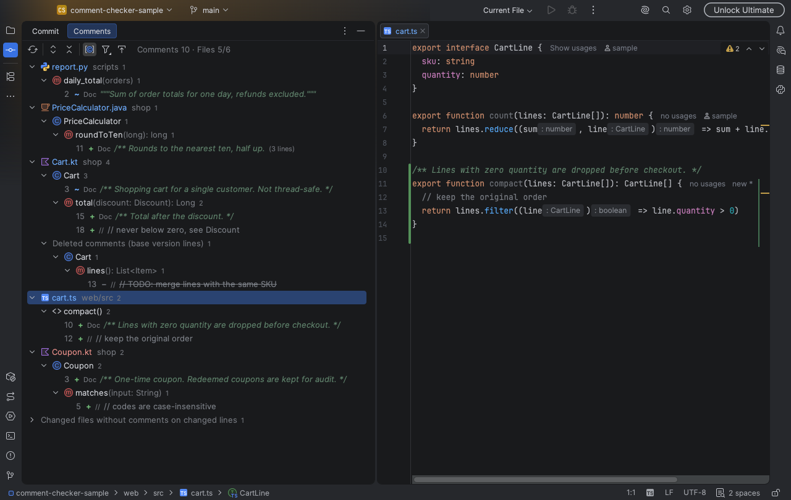
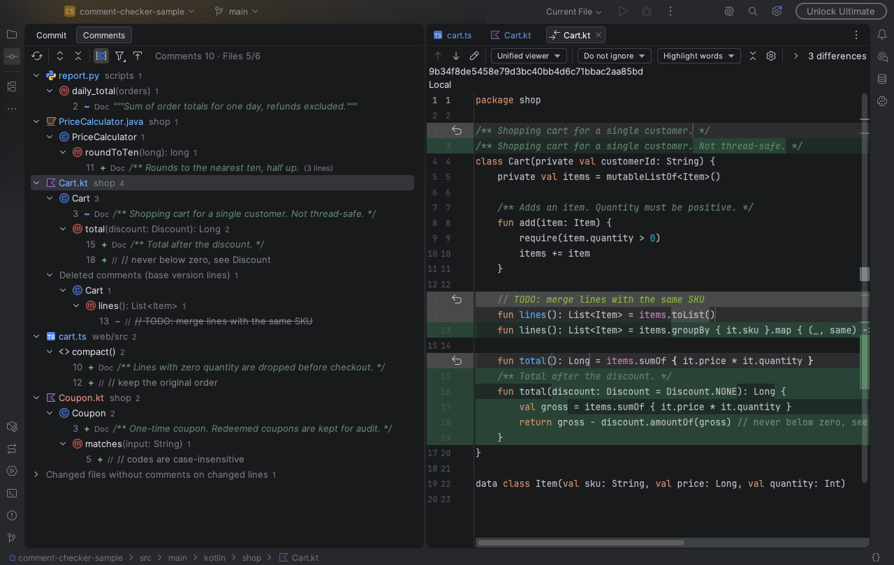

# Comment Checker (JetBrains IDE 플러그인)

[English](README.md) · 한국어

Commit 창에 **Comments** 탭을 붙인다. Commit 창에 오른 파일(Changes·Unversioned Files)에서 바뀐 줄에 걸친 주석만 모아 파일 → 클래스 → 메서드 순으로 보여준다.



지워진 주석도 목록에 나오고 Diff 로 열린다.



## 지원 범위

- IDE: IntelliJ IDEA, PyCharm 등 JetBrains IDE 2026.1 이상 (Java·Kotlin·Python 플러그인은 선택 의존).
- 화면 언어: IDE 언어를 따름. 한국어 언어팩을 켠 IDE 는 한국어, 그 밖에는 영어.
- 언어
  - Java·Kotlin·Python: 전용 규칙. Python 은 docstring 을 문서 주석으로 포함.
  - 그 밖에 IDE 가 파싱하고 주석 문법이 있는 언어(XML, YAML, SQL, TS 등): 주석은 다 잡고, 클래스·함수는 편집기 브레드크럼으로 붙임.
    JavaScript·TypeScript(JSX 포함)·Go 는 테스트와 실제 저장소로 확인함. 시그니처는 브레드크럼에 나오는 만큼만(Go 는 전체, JS·TS 는 `find()`).
  - 언어 플러그인이 없는 파일(예: 무료 IntelliJ 의 TS·Go)은 확인하지 않는다. "언어 플러그인이 없어 확인 못 한 파일" 묶음에 따로 보여서 주석이 없는 파일과 헷갈리지 않는다.

## 설치

```bash
JAVA_HOME=~/Library/Java/JavaVirtualMachines/ms-21.0.12/Contents/Home ./gradlew buildPlugin
```

`build/distributions/comment-checker-jetbrains-1.0.0.zip` 을 Settings → Plugins → ⚙ → **Install Plugin from Disk…** 로 설치한다.

## 쓰는 법

- Commit 창(⌘0) 위쪽 탭 줄의 **Comments**.
- Commit 창에서 파일을 우클릭 → **바뀐 주석 보기**(영어 IDE 는 Show Changed Comments)로 그 파일 위치로 바로 간다.
- 더블클릭·Enter·F4: 그 줄로 이동. 삭제된 주석은 현재 파일에 없으니 Diff 를 연다.
- 우클릭 → Diff 보기.
- 툴바: 새로고침, 펼치기/접기, 클래스·메서드로 묶기(끄면 파일 아래 목록), 주석 종류 필터, 선택하면 바로 이동(autoscroll).

표시

| 표시 | 뜻 |
|---|---|
| `+` | 새로 쓴 주석 |
| `~` | 일부 줄이 바뀌었거나, 같은 변경 구간에서 문구가 바뀐 주석. 툴팁에 이전 문구 |
| `−` | 지워진 주석. "삭제된 주석" 묶음 아래 기준 버전 위치로 |

## 판정 규칙

- 대상 파일: Commit 창에 보이는 파일 전부(Changes·Unversioned Files). git 에서 새 파일은 `git add` 전까지 Unversioned 라 빼면 새 파일 주석이 다 빠진다. .gitignore 에 든 파일은 안 본다.
- 바뀐 줄: Commit 창과 같은 기준(HEAD ↔ 작업본). 저장 안 한 편집도 포함. Unversioned 파일은 전체가 새 줄.
- 주인 선언
  - 선언 바로 위 주석(빈 줄 없이)은 그 선언. KDoc/Javadoc 포함.
  - `코드 // 주석` 꼬리 주석은 그 줄에서 끝나는 선언.
  - 나머지는 감싸는 선언. 함수 안 지역 변수·지역 클래스·익명 클래스·람다는 선언으로 치지 않는다.
- 코드만 바뀌고 주석 문구가 같으면(꼬리 주석, 들여쓰기 변경) 표시하지 않는다.

## 알려진 한계

- 비교 기준은 HEAD ↔ 작업본뿐. 브랜치 전체(예: `dev` 이후 커밋분)는 안 된다.
- .gitignore 에 안 넣은 생성 파일·임시 파일도 Unversioned 로 잡혀 목록에 섞인다. 거르려면 .gitignore 에 넣는다.
- 전용 규칙이 없는 언어는 브레드크럼에 나오는 이름 있는 요소만 선언으로 친다. 언어마다 브레드크럼 구성이 달라 결과가 조금씩 다를 수 있다.
  - 함수 매개변수와 본문 안에 선언한 것(Go `x := 1`, JS `const`·`var`·`function`, 객체 키, `useMutation({ onSuccess() {} })` 같은 콜백), JSX 태그는 선언으로 치지 않는다. `function Card() {…}` 와 `const Card = () => {…}` 모두 같다. IIFE·`define(function(){…})` 처럼 이름 없는 함수로 감싼 안쪽 함수는 선언으로 치고, 변수는 치지 않는다.
  - TS 데코레이터가 붙은 필드(`@Input() name`)는 위 주석이 필드가 아니라 클래스에 붙는다.
  - 테스트의 `describe`·`it` 콜백처럼 이름 없는 함수 안 주석은 주인 없이 파일 아래에 붙는다.
  - HTML 안 `<script>` 의 JS 주석은 함수가 아니라 `html › body › script` 아래에 붙는다.
- `build.gradle.kts` 같은 Kotlin 스크립트는 선언을 지역으로 봐서 주석이 파일 바로 아래에 붙는다.
- 1MB 넘는 파일은 건너뛴다.

## 개발

```bash
./gradlew test       # 판정 로직 테스트. Python 플러그인 경로가 다르면 -PpythonPlugin=<경로>. Go 플러그인이 없으면 Go 테스트는 빠짐(-PgoPlugin=<경로> -PgoTemplatePlugin=<경로>)
./gradlew verifyPlugin                 # 마켓 심사 도구로 설치된 IntelliJ 대상 검증
./gradlew verifyPlugin -PverifyPyCharm  # PyCharm 2026.1 도 검증 (처음 한 번 PyCharm 을 내려받음)
./gradlew runIde     # 샌드박스 IDE 로 띄워 보기
# 실제 저장소의 변경으로 패널을 PNG 로 그려 보기 (IDE 창 없이)
./gradlew test --tests '*PanelSnapshotTest*' --rerun -PsnapshotRepo=<저장소> -PsnapshotBase=dev -PsnapshotOut=/tmp/panel.png
```

`/Applications/IntelliJ IDEA.app` 을 빌드 대상으로 쓴다. 다른 위치면 `-PlocalIde=<경로>`.

## 라이선스

MIT. [LICENSE](LICENSE) 참고.
