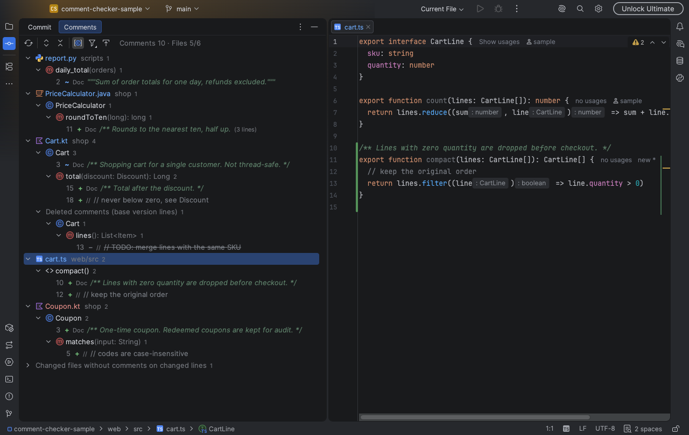
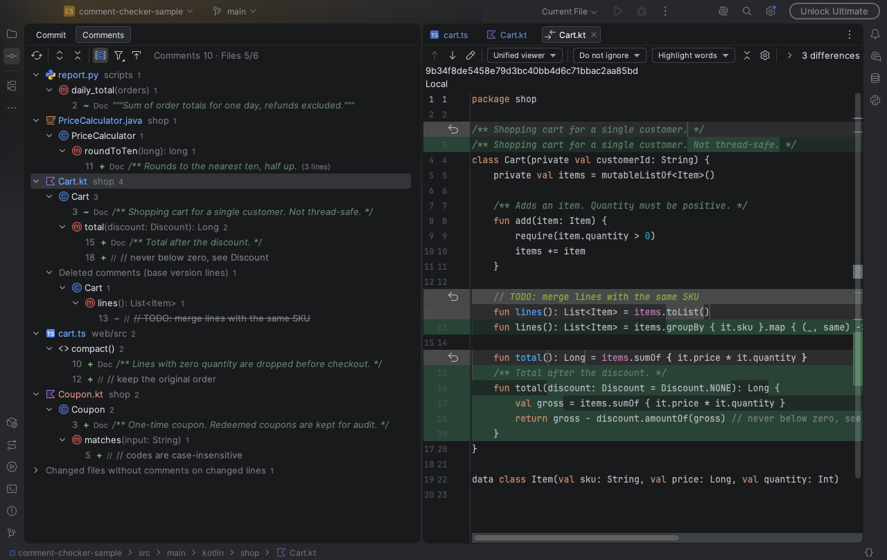

# Comment Checker (JetBrains IDE plugin)

English · [한국어](README.ko.md)

Adds a **Comments** tab to the Commit tool window. It collects only the comments on changed lines of the files shown there (Changes and Unversioned Files) and groups them by file → class → method.



Deleted comments are listed too and open in the diff.



## Supported

- IDEs: IntelliJ IDEA, PyCharm and other JetBrains IDEs, 2026.1 or later. The Java, Kotlin and Python plugins are optional dependencies.
- UI language: follows the IDE language. Korean when the Korean language pack is active, English otherwise.
- Languages
  - Java, Kotlin, Python: dedicated rules. Python docstrings count as doc comments.
  - Other languages the IDE parses and that have comment syntax (XML, YAML, SQL, TS, …): all comments are found, and classes and functions come from the editor breadcrumbs.
    JavaScript, TypeScript (including JSX) and Go are verified with tests and real repositories. Signatures are only as detailed as the breadcrumbs (full for Go, `find()` for JS/TS).
  - Files whose language plugin is not installed (e.g. TS or Go in the free IntelliJ IDEA) are not checked. They are listed under "Not checked: no language plugin installed", so they do not look like files without comments.

## Install

```bash
./gradlew buildPlugin    # needs JDK 21 (JAVA_HOME)
```

Install `build/distributions/comment-checker-jetbrains-1.0.0.zip` with Settings → Plugins → ⚙ → **Install Plugin from Disk…**.

## Usage

- The **Comments** tab in the tab row at the top of the Commit tool window (⌘0).
- Right-click a file in the Commit window → **Show Changed Comments** jumps straight to that file.
- Double-click, Enter or F4: go to that line. A deleted comment is not in the current file, so the diff opens instead.
- Right-click → Show Diff.
- Toolbar: refresh, expand/collapse all, group by class and method (off shows a flat list under each file), comment type filter, autoscroll to source.

Marks

| Mark | Meaning |
|---|---|
| `+` | New comment |
| `~` | Some of its lines changed, or its text changed within the same changed range. The tooltip shows the previous text |
| `−` | Deleted comment. Listed under "Deleted comments", at its line in the base version |

## Rules

- Files: everything shown in the Commit window (Changes and Unversioned Files). In git, a new file stays Unversioned until `git add`, so leaving those out would drop every comment in new files. Files in .gitignore are not read.
- Changed lines: the same basis as the Commit window (HEAD ↔ working copy). Unsaved edits are included. An Unversioned file counts as entirely new.
- Owner declaration
  - A comment right above a declaration (no blank line) belongs to that declaration. KDoc/Javadoc included.
  - A trailing `code // comment` belongs to the declaration that ends on that line.
  - Anything else belongs to the enclosing declaration. Local variables, local classes, anonymous classes and lambdas inside a function do not count as declarations.
- If only code changed and the comment text is the same (trailing comments, indentation changes), the comment is not shown.

## Known limitations

- The only comparison basis is HEAD ↔ working copy. A whole branch (e.g. commits since `dev`) is not supported.
- Generated or scratch files not in .gitignore show up as Unversioned and mix into the list. Add them to .gitignore to filter them out.
- For languages without dedicated rules, only named elements shown in the breadcrumbs count as declarations. Breadcrumbs differ by language, so results can vary slightly.
  - Function parameters, everything declared inside a function body (Go `x := 1`, JS `const`/`var`/`function`, object keys, callbacks such as `useMutation({ onSuccess() {} })`) and JSX tags do not count as declarations. This holds for `const Card = () => {…}` as well as `function Card() {…}`. Functions inside an anonymous wrapper such as an IIFE or `define(function(){…})` do count; variables there do not.
  - For a TS field with a decorator (`@Input() name`), the comment above attaches to the class, not the field.
  - Comments inside anonymous callbacks such as test `describe`/`it` have no owner and sit directly under the file.
  - JS comments in an HTML `<script>` attach to `html › body › script`, not to the function.
- Kotlin scripts such as `build.gradle.kts` treat declarations as local, so their comments sit directly under the file.
- Files over 1 MB are skipped.

## Development

```bash
./gradlew test       # rule tests. -PpythonPlugin=<path> if the Python plugin is elsewhere. Go tests are skipped without the Go plugin (-PgoPlugin=<path> -PgoTemplatePlugin=<path>)
./gradlew verifyPlugin                 # Marketplace verifier against the installed IntelliJ IDEA
./gradlew verifyPlugin -PverifyPyCharm  # also verify PyCharm 2026.1 (downloads PyCharm the first time)
./gradlew runIde     # launch a sandbox IDE
# render the panel for a real repository's changes as a PNG (no IDE window)
./gradlew test --tests '*PanelSnapshotTest*' --rerun -PsnapshotRepo=<repo> -PsnapshotBase=dev -PsnapshotOut=/tmp/panel.png
```

Builds against `/Applications/IntelliJ IDEA.app`. Use `-PlocalIde=<path>` for another location.

## Translations

UI text lives in `src/main/resources/messages/CommentCheckerBundle.properties` (English) and `CommentCheckerBundle_ko.properties` (Korean). Add every key to both; `BundleTest` checks that the keys and placeholders match.

## License

MIT. See [LICENSE](LICENSE).
