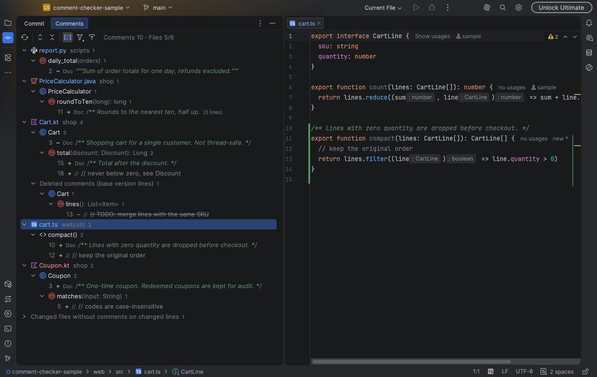
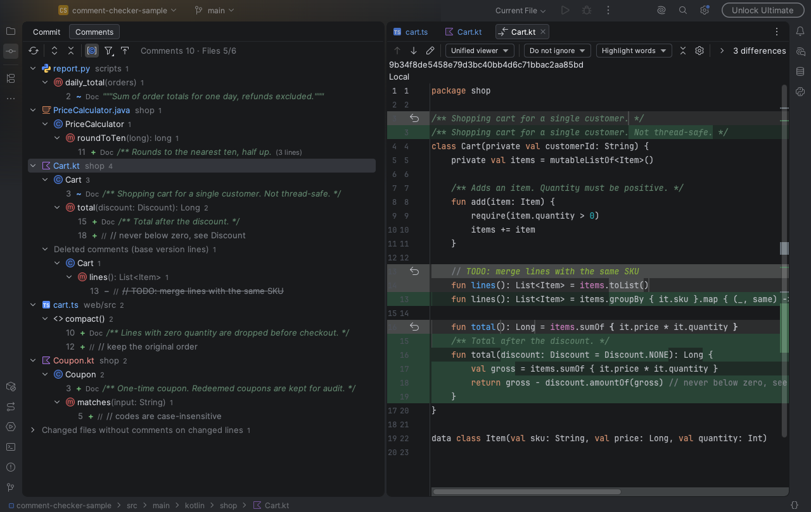

# Comment Checker (JetBrains IDE plugin)

English · [한국어](README.ko.md)

Adds a **Comments** tab to the Commit tool window. It collects only the comments on changed lines of the files shown there (Changes and Unversioned Files) and groups them by file → class → method.



Deleted comments are listed too and open in the diff.



## Supported

- IDEs: IntelliJ IDEA, PyCharm and other JetBrains IDEs, 2026.1 or later.
- UI language: follows the IDE language. Korean when the Korean language pack is active, English otherwise.
- Languages: any language with an installed language plugin. Whatever the plugin recognizes as a comment is listed, in source code, build scripts, CI workflows and config files alike.
- Files that open without a language plugin (highlighting only) are not checked. They are listed under "Not checked: no language plugin installed", so they don't look comment-free.

## Install

Settings → Plugins → Marketplace, search for **Comment Checker** and install. Also on [JetBrains Marketplace](https://plugins.jetbrains.com/plugin/36103-comment-checker).

To install from a zip, download it from [Releases](https://github.com/ukukj/comment-checker-jetbrains/releases) or build it:

```bash
./gradlew buildPlugin    # needs JDK 21 (JAVA_HOME)
```

Then install `build/distributions/comment-checker-jetbrains-<version>.zip` with Settings → Plugins → ⚙ → **Install Plugin from Disk…**.

## Usage

- The **Comments** tab in the tab row at the top of the Commit tool window (⌘0).
- Right-click a file in the Commit window → **Show Changed Comments** jumps straight to that file.
- Double-click, Enter or F4: go to that line. A deleted comment is not in the current file, so the diff opens instead.
- Right-click → Show Diff.
- Toolbar: refresh, expand/collapse all, group by class and method (off shows a flat list under each file), comment type filter, autoscroll to source.

Marks

| Mark | Meaning |
|---|---|
| `+` | New comment |
| `~` | Some of its lines changed, or its text changed within the same changed range. The tooltip shows the previous text |
| `−` | Deleted comment. Listed under "Deleted comments", at its line in the base version |

## Rules

- Files: everything shown in the Commit window (Changes and Unversioned Files). In git, a new file stays Unversioned until `git add`, so leaving those out would drop every comment in new files. Files in .gitignore are not read.
- Changed lines: the same basis as the Commit window (HEAD ↔ working copy). Unsaved edits are included. An Unversioned file counts as entirely new.
- Owner declaration
  - A comment right above a declaration (no blank line) belongs to that declaration. Doc comments included.
  - A trailing comment after code belongs to the declaration that ends on that line.
  - Anything else belongs to the enclosing declaration. Parameters, local variables, lambdas, callbacks and anonymous classes inside a function do not count as declarations.
- If only code changed and the comment text is the same (trailing comments, indentation changes), the comment is not shown.

## Known limitations

- The only comparison basis is HEAD ↔ working copy. A whole branch (e.g. commits since `dev`) is not supported.
- Generated or scratch files not in .gitignore show up as Unversioned and mix into the list. Add them to .gitignore to filter them out.
- Declarations are read from the language plugin, so grouping can differ slightly between languages.
  - Code embedded in another file type, such as a script in markup, is grouped by the outer file's structure.
  - Where the language plugin exposes no declarations, as in some script files, comments sit directly under the file.
- Files over 1 MB are skipped.

## Development

```bash
./gradlew test       # rule tests. -PpythonPlugin=<path> if the Python plugin is elsewhere. Go tests are skipped without the Go plugin (-PgoPlugin=<path> -PgoTemplatePlugin=<path>)
./gradlew verifyPlugin                 # Marketplace verifier against the installed IntelliJ IDEA
./gradlew verifyPlugin -PverifyPyCharm  # also verify PyCharm 2026.1 (downloads PyCharm the first time)
./gradlew runIde     # launch a sandbox IDE
# render the panel for a real repository's changes as a PNG (no IDE window)
./gradlew test --tests '*PanelSnapshotTest*' --rerun -PsnapshotRepo=<repo> -PsnapshotBase=dev -PsnapshotOut=/tmp/panel.png
```

Builds against `/Applications/IntelliJ IDEA.app`. Use `-PlocalIde=<path>` for another location. Without an installed IDE (e.g. in CI), IntelliJ IDEA 2026.1 is downloaded.

## Translations

UI text lives in `src/main/resources/messages/CommentCheckerBundle.properties` (English) and `CommentCheckerBundle_ko.properties` (Korean). Add every key to both; `BundleTest` checks that the keys and placeholders match.

## License

MIT. See [LICENSE](LICENSE).
